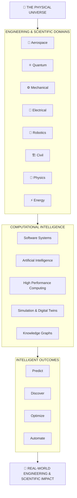

# ◈ SANDEEP KULKARNI

<p align="center">
  
</p>

<h1 align="center">
  ⚛️ AEROSPACE × QUANTUM × MECHANICAL × SOFTWARE
</h1>

<h3 align="center">
  Connecting disciplines. Engineering intelligence. Exploring the unknown.
</h3>

<p align="center">
  <a href="https://git.io/typing-svg">
    
  </a>
</p>

<p align="center">
  
  
  
</p>

---

# ◈ 01 — ABOUT THE ENGINEER

**Hello, I'm Sandeep Kulkarni.**

I'm a software engineer fascinated by the intersection of computation, artificial intelligence, science and engineering.

My curiosity goes beyond conventional software development.

I explore how intelligent software systems can connect the digital and physical worlds — from aerospace and spacecraft to mechanical systems, quantum computing, physics, materials science, robotics and industrial intelligence.

I believe some of the most important technological breakthroughs will emerge not from working within one discipline, but from connecting several disciplines into one intelligent ecosystem.

**My central question:**

> What could humanity build if software, AI, science and every branch of engineering worked together?

I enjoy translating complex ideas into architectures, prototypes, experiments and eventually working systems.

---

# ⌬ 02 — THE ENGINEERING MULTIVERSE

<p align="center">
  
</p>

### 🚀 Aerospace, Aviation & Space Systems

Exploring the software and computational foundations behind flight, spacecraft and space operations.

- Orbital mechanics and astrodynamics
- Flight dynamics and control systems
- Propulsion and spacecraft architecture
- Aircraft systems and avionics
- Guidance, Navigation and Control (GNC)
- Satellite intelligence and constellation systems
- Predictive maintenance and aviation safety
- Aerospace digital twins and mission simulation

<p align="center">
  
</p>

### ⚛️ Quantum Computing & Future Computation

Exploring computational paradigms beyond conventional computing.

- Quantum computing fundamentals
- Qubits, quantum gates and circuits
- Quantum algorithms and quantum information
- Quantum simulation
- High-performance computing (HPC)
- Scientific and numerical computation
- Hybrid classical–quantum architectures
- Emerging computational technologies

<p align="center">
  
</p>

### ⚙️ Mechanical, Manufacturing & Materials Engineering

Interested in how physical products are designed, analyzed, manufactured and optimized.

- Computer-Aided Design (CAD)
- Computer-Aided Engineering (CAE)
- Finite Element Analysis (FEA)
- Computational Fluid Dynamics (CFD)
- Thermodynamics and heat transfer
- Fluid mechanics and structural mechanics
- Materials science and metallurgy
- Geometric Dimensioning and Tolerancing (GD&T)
- Advanced manufacturing and production systems
- Reliability engineering and failure analysis
- Product Lifecycle Management (PLM)

<p align="center">
  
</p>

### 🔌 Electrical, Electronics & Embedded Systems

- Electronic circuit systems
- Semiconductor technologies
- Embedded systems and firmware
- Sensors, instrumentation and telemetry
- Signal processing
- Power electronics and electrical machines
- Control engineering
- Industrial automation and IoT

<p align="center">
  
</p>

### 🤖 Robotics, Control & Autonomous Intelligence

- Robotics and mechatronics
- Autonomous navigation
- Motion planning and control
- Computer vision
- Sensor fusion
- Intelligent control systems
- Human–machine interaction
- Multi-agent autonomous systems

<p align="center">
  
</p>

### 🔬 Scientific, Mathematical & Computational Research

- Applied mathematics and numerical methods
- Computational physics
- Materials discovery
- Scientific machine learning
- Simulation and optimization
- Research knowledge graphs
- Computational chemistry
- Multiphysics modeling

<p align="center">
  
</p>

### 🏗️ Civil, Structural & Infrastructure Engineering

- Structural engineering
- Computational structural analysis
- Geotechnical engineering
- Smart infrastructure
- Construction technology
- Building Information Modeling (BIM)
- Infrastructure digital twins

<p align="center">
  
</p>

### ⚡ Energy, Chemical & Process Engineering

- Renewable and sustainable energy
- Energy systems and storage
- Battery technologies
- Chemical process engineering
- Process optimization
- Thermal systems
- Nuclear engineering fundamentals

<p align="center">
  
</p>

### 🔭 Physics, Astrophysics & Fundamental Sciences

Exploring the fundamental laws governing matter, energy, space, time and the universe.

- Classical mechanics and analytical mechanics
- Quantum mechanics and quantum field theory
- Theoretical and mathematical physics
- Astrophysics and cosmology
- General and special relativity
- Particle physics and high-energy physics
- Nuclear and atomic physics
- Condensed matter and solid-state physics
- Electromagnetism and electrodynamics
- Statistical mechanics and thermodynamics
- Plasma physics and fluid dynamics
- Computational physics and numerical simulations
- Gravitational physics and black hole research
- Origins, structure and evolution of the universe

<p align="center">
  
</p>

### 💻 Software Engineering & Artificial Intelligence

The computational layer connecting all these engineering disciplines.

- Enterprise software architecture
- Distributed systems and microservices
- Artificial Intelligence and LLMs
- Agentic AI and autonomous workflows
- Digital twins and simulation platforms
- Cloud-native applications
- Data engineering and knowledge graphs
- Scientific and engineering software
- Real-time data processing
- AI-powered decision intelligence

---

# ⬡ 03 — THE BIGGER PICTURE

### One physical universe. Multiple engineering disciplines. One interconnected intelligence layer.



My long-term interest is to help build this interconnected engineering ecosystem through software, computation and AI.

---

# ⌘ 04 — SOFTWARE & COMPUTING TOOLKIT

### Core Software Engineering

<p>
  
</p>

### Cloud, Data & Infrastructure

<p>
  
</p>

### Engineering & Scientific Technology

<p align="left">
  
  
  
  
  
  
</p>

My primary professional software foundation is Java and Spring Boot, alongside enterprise APIs, microservices, integrations, cloud technologies, testing and observability.

I'm continuously expanding into Go, Python, AI systems and scientific computing.

---

# ◈ 05 — HOW I ENGINEER

```text
01. OBSERVE       → Understand the real-world problem.

02. INVESTIGATE   → Research the science and engineering.

03. ABSTRACT      → Model the system and its interactions.

04. ARCHITECT     → Design the computational foundation.

05. INTEGRATE     → Connect data, AI, simulations and systems.

06. EXPERIMENT    → Build prototypes and test assumptions.

07. VALIDATE      → Measure accuracy, performance and reliability.

08. EVOLVE        → Improve toward an intelligent, scalable system.
```

### My Engineering Principles

- Systems thinking over isolated features.
- First principles over blind assumptions.
- Mathematics and physics where the problem demands them.
- Interdisciplinary collaboration over technology silos.
- Evidence and experimentation over hype.
- Reliability, safety and security by design.
- Practical implementation over endless architectural diagrams.

---

# 🌌 06 — THE FRONTIER

The questions that keep my curiosity alive:

- Can AI accelerate the discovery of new materials?
- Can we build digital twins that understand the entire lifecycle of an aircraft?
- Can quantum computing unlock new approaches to scientific simulation?
- Can intelligent systems predict mechanical failures before they happen?
- Can engineering knowledge from every discipline become interconnected?
- Can autonomous systems collaborate across aerospace, manufacturing and scientific research?
- Can physics and advanced computation help us understand the deepest mysteries of the universe?
- What would an intelligent operating system for the physical world look like?

I may not have all the answers.

**But I want to build the systems that help us discover them.**

---

# 📊 07 — GITHUB MISSION CONTROL

<p align="center">
  
  
</p>

<p align="center">
  
</p>

<p align="center">
  
</p>

<p align="center">
  <i>Every commit is a small step toward a larger system.</i>
</p>

---

# 🤝 08 — COLLABORATION TRANSMISSION

Interested in collaborating, researching or exchanging ideas around:

- Aerospace and space technology
- Quantum computing and advanced computation
- Mechanical and industrial engineering
- Physics, astrophysics and scientific computing
- AI, robotics and autonomous systems
- Scientific software and digital twins
- Open-source engineering platforms
- Deep-tech research and development

I'm particularly interested in people who think across disciplines and enjoy turning difficult problems into working systems.

<p align="center">
  <a href="https://github.com/sandeepkulkarni17">
    
  </a>
</p>

---

<p align="center">
  
</p>

<h2 align="center">
  THINK BEYOND DISCIPLINES.
</h2>

<h3 align="center">
  CONNECT KNOWLEDGE. ENGINEER POSSIBILITIES.
</h3>

<p align="center">
  <b>THE FUTURE IS INTERDISCIPLINARY.</b>
</p>

<p align="center">
  ◈ SANDEEP KULKARNI ◈
</p>
